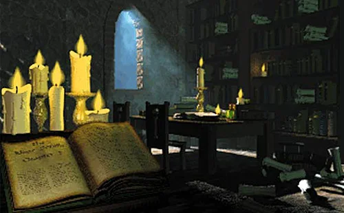
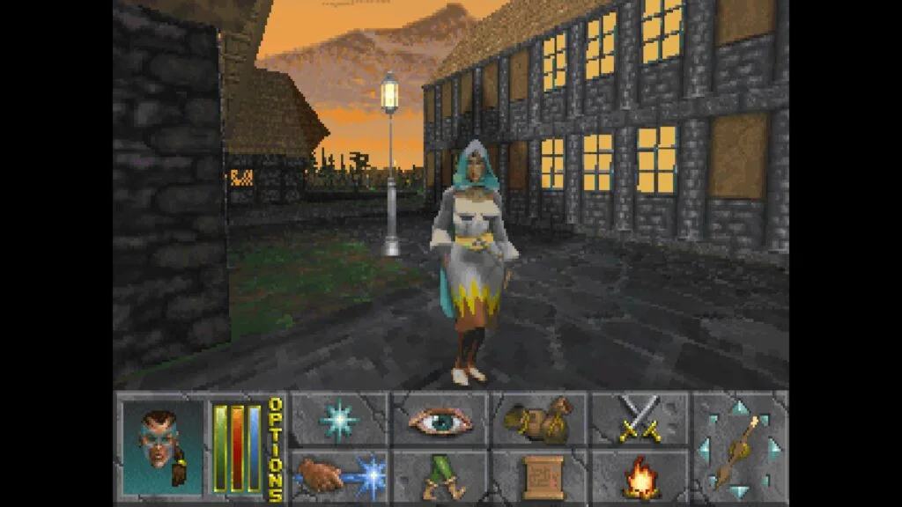

# Daggerfall Online

**[Visit daggerfall.online →](https://daggerfall.online/)**

### Your next journey through the Iliac Bay starts here

**Daggerfall Online** is an independent community website for players who want to revisit *The Elder Scrolls II: Daggerfall* through a browser. Explore the browser multiplayer, prepare your original game files, and find clear guidance on browser play and the DFO Online multiplayer project.

The homepage puts a widescreen game frame near the top, with fullscreen and expanded views. File setup, multiplayer guidance, and troubleshooting are close at hand when you need them.

[Play Daggerfall Online](https://daggerfall.online/#game-player) · [Start with the guide](https://daggerfall.online/how-to-play/)

*Original-game reference image: revisit the setting and systems that made Daggerfall a memorable role-playing adventure.*

### Find your starting point

| What you want to do | Where to go |
| --- | --- |
| Try the browser client | [Play multiplayer](https://daggerfall.online/#game-player) |
| Find and import your own ARENA2 files | [Game file setup](https://daggerfall.online/arena2-setup/) |
| Understand online play and its current availability | [Multiplayer guide](https://daggerfall.online/multiplayer/) |
| Compare classic Daggerfall, Unity, and DFO Online | [Version guide](https://daggerfall.online/versions/) |
| Resolve loading, controls, or save questions | [Troubleshooting](https://daggerfall.online/troubleshooting/) |
| Check what is currently available | [Service status](https://daggerfall.online/status/) |

*Daggerfall Unity reference image; not a screenshot of a live multiplayer session on this website.*

### Before you enter

Bring your own original game files; they are not included. The browser client requires WebGL2. Touch controls are included; device performance and browser capabilities vary.

**Play Daggerfall Online multiplayer with friends.** Follow the [illustrated multiplayer guide](https://daggerfall.online/multiplayer/) to create online characters, invite a party and meet outside the solo starting dungeon. New players can use the [beginner guide](https://daggerfall.online/beginner-guide/) for downloads, imports, controls and the map.

**[Visit daggerfall.online and explore the client →](https://daggerfall.online/)**

## Prepare for the right experience

Daggerfall has several related versions, and it helps to know which one a guide is discussing. Classic Daggerfall, Daggerfall Unity and the DFO Online browser project share a setting but should not be treated as identical clients. A screenshot from a related version is useful illustration, not proof of what a live browser session will look like.

Read the version guide before transferring expectations from another edition. Controls, available systems and the way a session is started may differ. If you are returning after a long break, the beginner guide provides a more practical route into play than trying to remember every detail from a previous desktop experience.

## Understand the original-data requirement

The website does not include the original game data for you. Its game-file guide explains the role of the ARENA2 files and the preparation expected of a player. Follow that guide with your own appropriate files rather than assuming that opening the page is enough to provide every required asset. Keep your original files available while you work through the instructions.

File selection is a player-facing step, not a reason to change browser security settings blindly. If the client does not recognize the material you selected, consult the troubleshooting information and check what the guide actually asks for. Avoid repeatedly replacing unrelated files in the hope that an unclear error will disappear.

## Begin with orientation

Once you reach the game, spend a little time learning the controls and locating the map. Movement, interaction and navigation are easier to understand when you are not simultaneously trying to coordinate a group. The beginner material provides a starting point for those tasks, including the relationship between an early solo area and later online play.

The opening dungeon is not the same as a shared meeting place. If you are arranging to play with friends, follow the multiplayer guide's sequence and agree on where you expect to meet. A character being visible on your own screen does not by itself establish that everyone has joined the same session or reached the same location.

## Coordinate a group deliberately

The multiplayer guide covers online characters, parties and meeting outside the starting dungeon. Read the relevant section together before trying to diagnose a missing party member. Compare the intended location and the state each person has reached. A simple shared plan often prevents confusion that could otherwise look like a connection problem.

Availability can change, so consult the service-status page when something unexpected happens. A guide describes the intended workflow; it is not a guarantee that every service is currently reachable from every network. If the client or a connection fails, record the visible message and the action that preceded it rather than assuming your character or files are permanently lost.

## Take care with browser sessions

The browser client requires WebGL2 and is affected by device capability. A page loading successfully does not guarantee that a demanding game scene will run comfortably on every device. Touch controls are included, but a small screen and a desktop pointing device provide different experiences. Choose a setup where you can read the game and reach the controls without unnecessary strain.

Before leaving a session, use the game's documented save workflow and check the feedback it provides. Do not assume that closing a tab is equivalent to saving. The troubleshooting guide is the appropriate place to investigate save questions, especially when changing browsers or devices. Keep important original material outside temporary browser state.

## Use help pages as a map

The website separates controls, game-file preparation, version comparison, multiplayer guidance and troubleshooting so that you can go directly to the relevant question. If you are unsure where a failure occurs, retrace the sequence: opening the client, providing the required files, reaching a character and entering the intended activity. That description is useful when asking for help.

Daggerfall Online is an independent community destination. It does not represent Bethesda, ZeniMax or the upstream development teams. The credits page explains related work and image sources. Reference artwork should be understood in that context, and neither a logo nor an illustrative scene should be mistaken for evidence of a currently active multiplayer session.
