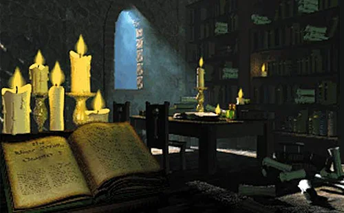
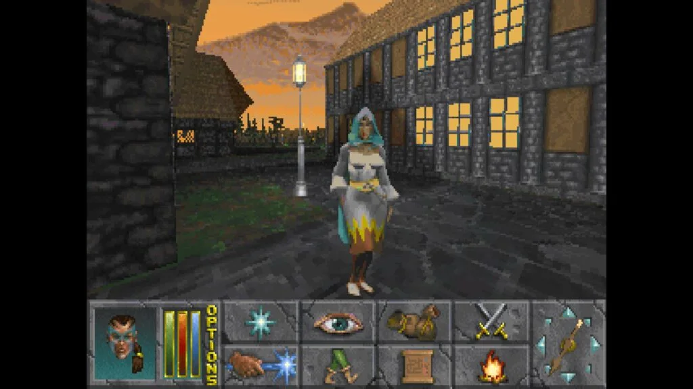

# Daggerfall Online

**[Visit daggerfall.online →](https://daggerfall.online/)**

[English](#english) · [繁體中文](#繁體中文)

## English

### Your next journey through the Iliac Bay starts here

**Daggerfall Online** is an independent community website for players who want to revisit *The Elder Scrolls II: Daggerfall* through a browser. Explore the browser multiplayer, prepare your original game files, and find clear guidance on browser play and the DFO Online multiplayer project.

The homepage puts a widescreen game frame near the top, with fullscreen and expanded views. File setup, multiplayer guidance, and troubleshooting are close at hand when you need them.

[Play Daggerfall Online](https://daggerfall.online/#game-player) · [Start with the guide](https://daggerfall.online/how-to-play/)

*Original-game reference image: revisit the setting and systems that made Daggerfall a memorable role-playing adventure.*

### Find your starting point

| What you want to do | Where to go |
| --- | --- |
| Try the browser client | [Play multiplayer](https://daggerfall.online/#game-player) |
| Find and import your own ARENA2 files | [Game file setup](https://daggerfall.online/arena2-setup/) |
| Understand online play and its current availability | [Multiplayer guide](https://daggerfall.online/multiplayer/) |
| Compare classic Daggerfall, Unity, and DFO Online | [Version guide](https://daggerfall.online/versions/) |
| Resolve loading, controls, or save questions | [Troubleshooting](https://daggerfall.online/troubleshooting/) |
| Check what is currently available | [Service status](https://daggerfall.online/status/) |

*Daggerfall Unity reference image; not a screenshot of a live multiplayer session on this website.*

### Before you enter

Bring your own original game files; they are not included. The browser client requires WebGL2. Touch controls are included; device performance and browser capabilities vary.

**Play Daggerfall Online multiplayer with friends.** Follow the [illustrated multiplayer guide](https://daggerfall.online/multiplayer/) to create online characters, invite a party and meet outside the solo starting dungeon. New players can use the [beginner guide](https://daggerfall.online/beginner-guide/) for downloads, imports, controls and the map.

**[Visit daggerfall.online and explore the client →](https://daggerfall.online/)**

## 繁體中文

### 從這裡開始，重返伊利亞克灣

**Daggerfall Online** 是面向《上古卷軸 II：匕首雨》玩家的獨立社群網站，提供瀏覽器多人游戏、原版遊戲檔案準備說明，以及 DFO Online 多人專案與各版本的入門指南。

首頁前方設有寬螢幕遊戲框，支援全螢幕與展開檢視。需要協助時，可以查看檔案匯入、多人遊玩和疑難排解說明。

[開啟多人游戏](https://daggerfall.online/#game-player) · [閱讀入門指南](https://daggerfall.online/how-to-play/)

*原版遊戲參考圖片：認識《匕首雨》的世界，以及這款經典角色扮演遊戲的冒險體驗。*

### 找到適合你的入口

| 想做的事情 | 對應入口 |
| --- | --- |
| 體驗瀏覽器客戶端 | [多人游戏](https://daggerfall.online/#game-player) |
| 取得並匯入自己的 ARENA2 檔案 | [遊戲檔案設定](https://daggerfall.online/arena2-setup/) |
| 了解多人玩法與目前開放狀態 | [多人指南](https://daggerfall.online/multiplayer/) |
| 比較原版、Daggerfall Unity 與 DFO Online | [版本介紹](https://daggerfall.online/versions/) |
| 處理載入、操作與存檔問題 | [疑難排解](https://daggerfall.online/troubleshooting/) |
| 查看目前可用的功能 | [服務狀態](https://daggerfall.online/status/) |

*Daggerfall Unity 參考圖片，並非本站已開放多人連線的實測截圖。*

### 開始之前

請自行準備原版遊戲檔案，本站不附帶原版資料。瀏覽器客戶端需要 WebGL2；客戶端包含觸控操作，实际体验取决于设备和浏览器。

**多人版可以联机游玩。** 跟随[图文多人指南](https://daggerfall.online/multiplayer/)找到 Online、新建在线角色、邀请组队并在室外会合。[新手指南](https://daggerfall.online/beginner-guide/)提供下载、导入、移动和地图说明。

**[前往 daggerfall.online，探索客戶端 →](https://daggerfall.online/)**

---

An independent, unofficial community project based on [DFO Online](https://github.com/Lattymoy/daggerfall-js-source) and [Daggerfall Unity](https://www.dfworkshop.net/). Not affiliated with Bethesda, ZeniMax, or the upstream development teams. Reference images: [original Daggerfall](https://store.steampowered.com/app/1812390/) and [Daggerfall Unity](https://www.dfworkshop.net/daggerfall-unity-0-10-28/). See [credits](https://daggerfall.online/credits/).

本站為獨立、非官方社群專案，與 Bethesda、ZeniMax 或上游開發團隊無隸屬關係。品牌與參考圖片權利歸各自權利人所有，詳見[鳴謝與來源](https://daggerfall.online/credits/)。
